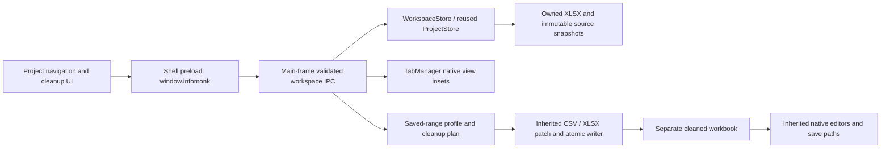
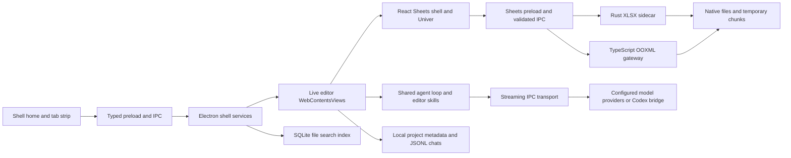

# GenOffice architecture and Infomonk extension boundaries

Audit date: 9 October 2026. Upstream revision:
`1ca5e9adfc1807a158db19741eff825dba9ab757`.

This describes source-confirmed architecture. Runtime evidence and limitations
are recorded separately in [docs/audit/verification.md](docs/audit/verification.md).
The inherited architecture below is the audited baseline. The implemented Infomonk
seam is described next; later dataset/execution boundaries remain recommendations.

## Implemented Infomonk seam (Stages 1–2)

- `apps/shell/src/shared/workspace-api.ts` is the typed boundary. The shell preload
  exposes it; secondary editor preloads do not. `workspace-ipc.ts` verifies the
  requesting shell main frame and bounds IDs, paths, URLs and rule inputs with
  existing Zod. URL registration is HTTP(S) only; it does not retrieve content.
- `workspace-store.ts` adapts existing project creation, file membership and chat
  persistence. Optional versioned `WorkspaceMetadata` adds description, star,
  primary/previous workbook, sources and a bounded activity list. Existing editor
  projects remain readable; Infomonk's project list selects metadata version 1.
- Owned files live under `userData/projects/{projectId}/workspace`. Local source
  bytes live under `sources/{sha256}/{name}`. Opening a source verifies its hash
  and copies it into a separate `previews/{uuid}` directory before native viewing.
  Source copies have no automatic retention/pruning policy yet.
- CSV/TSV imports reuse the inherited decoder, delimiter/parser and XLSX writer.
  Existing XLSX imports copy the original. Document, text and goal starts create a
  real blank workbook; extraction is unavailable. Inputs are bounded to 32 MiB;
  imports and chosen cleanup ranges are bounded to 100,000 cells.
- `clean-table.ts` reads the saved workbook, profiles the full chosen range and
  constructs deterministic rule plans. A 15-minute preview token pins the source
  hash; stale saved content is rejected. Apply uses the inherited atomic writer
  for a separate cleaned XLSX and switches the metadata pointer only after writing.
  Per-project apply is serialized. Previous version swaps pointers, keeping files.
  This is filesystem persistence, not an accepted-dataset transaction/ledger.
- Scalar transformations skip formulas. Row-moving/removing transformations
  require the full A1 used worksheet and headers, no formulas anywhere in the
  workbook and no named ranges or unsupported advanced structures. Narrow OOXML
  patches preserve untouched package parts; flat-row movement carries row/cell
  styles. New date-format columns get readable widths.
- Flat managed rows carry `_infomonk_record_id` in a hidden column and a validated
  `infomonk/records.json` ZIP part referenced by package relationships. IDs link
  to saved workbook SHA, sheet and original row. They move with cleanup records
  and native full-row sorts, survive native save/reopen and XLSX export. Native
  partial-column sorts are blocked; assistant sort proposals for managed sheets
  are rejected before expansion can produce unrelated per-cell writes. These IDs
  are origin links, not validation of edited values. CSV omits ZIP metadata; helper
  editing/copying and arbitrary agent mutations are not a maintained-data contract.
- `Workspace.tsx` owns project chrome. `TabManager.setWorkspaceInsets` hosts live
  editors below the tab strip/project toolbar and beside navigation. Section
  changes hide views without disposal. Assistant/Details mode switches preserve
  the mounted inherited assistant. The sheet retains its existing runtime, grid,
  formula engine, editing journal, undo, filters, charts, file save and providers.

Product identity is Infomonk with a separate userData directory, original SVG and
installer assets. Internal `@genoffice/*` package names and locks stay unchanged.
Builder app ID is `com.infomonk.app`. Upstream GA4 credential injection is disabled;
only `INFOMONK_UPDATE_URL` can configure the fork's feed. Genspark auth/cloud/search
remain optional inherited integrations and keep their identity. Secondary editor
branding and some upstream help/repository links remain. Installers were not tested.

No new parser, dataset database, scheduler, connector framework or agent harness
has been installed. [IMPLEMENTATION_PLAN.md](IMPLEMENTATION_PLAN.md) defines the
accepted-data and extraction contracts for Stage 3.

## Inherited system

The npm monorepo has seven Electron workspaces: shell, docs, sheets, slides,
PDF, Markdown and HTML. The shell imports editor main-process modules into its
own build; each editor has a separate React renderer and preload bridge.
Shared TypeScript packages own file engines, providers, agent behavior and UI.

### Shell, navigation and file ownership

`apps/shell/src/renderer/src/AppFrame.tsx` now renders Workspace and the tab strip;
legacy Home remains reachable through Local files.
Editor content is an Electron `WebContentsView`, positioned over the shell
content area by `apps/shell/src/main/tab-manager.ts`; it is not a React page
mounted within Home. Keep that distinction when adding project navigation:
ordinary shell DOM cannot simply overlay an editor view.

Home calls the `HomeApi` exposed as `window.aiOffice`; tab actions use
`window.aiOfficeTabs`. The preload routes these to main-process handlers in
`apps/shell/src/main/index.ts`. Routing is centralized in `app-routing.ts`.
`folder-tree.ts` manages real directory operations and root boundaries;
`detached-windows.ts` transfers live views between windows.

Local search is already substantial. `file-index/store.ts` uses Node's
`DatabaseSync`, WAL and SQLite FTS5. `indexer.ts` scans roots and extra recent or
starred paths, compares size/mtime, and delegates bounded text extraction to a
worker. `extract.ts` limits content indexing to 64 MB files and one million
characters. This mutable, regenerable search cache is not a source snapshot or
an accepted-dataset database. Optional reranking sends bounded excerpts to a
configured provider and is off by default.

The visible Genspark Projects view is a separate signed-in cloud list.
`cloud-projects.ts` paginates and caches account-bound project links and opens
relative links on Genspark. It must not be mistaken for Infomonk project storage.

### Workbook import, editing and save

`apps/sheets/src/renderer/App.tsx` composes the workbook runtime and surrounding
features; `ExcelShell.tsx` supplies the ribbon, status and assistant layout.
`create-univer.ts` composes selected free presets, deliberately avoiding the
meta-package that would import proprietary Pro packages. The lockfile pins the
embedded Univer packages to 0.25.1; current standalone examples are not
automatically compatible.

The Rust sidecar uses Calamine, IronCalc, Quick XML and ZIP processing. Main owns
the process and opaque workbook sessions through `xlsx-sidecar-client.ts`.
Cells stream through typed `readWorkbookRange` requests. `univer-sync.ts`,
`view-transform.ts` and `edit-journal.ts` project streamed file content and pending
changes into the grid. The journal covers more than values: structures, filters,
styles, worksheet lifecycle, visuals, tables and other supported states.

There are distinct small-workbook formula and larger streamed modes. Current
source defaults are a 50,000 stored-cell formula-mode ceiling; Full Load has
separate limits of one million value cells, two million stored cells and a
ten-million-cell value bounding box. These are application gates, not measured
Infomonk capacity guarantees. Do not infer whole-table coverage from the viewport.

`plan-operations.ts` validates the workbook DSL and loading constraints.
`lazy-plan.ts` compares previewed cell content with current cell content;
structural operations do not have the same per-cell comparison.
`op-executor.ts` executes through Univer and records edits. Its `ApplyOutcome`
explicitly allows `partiallyApplied` and `undoDropped`; a workbook batch is not
an unconditional database transaction.

`save-actions.ts` serializes the journal and live supported states. The preload
and `sheets-main.ts` validate the request and own file writes.
`packages/xlsx-gateway/src/gateway/xlsx-package-io.ts` reads/patches declared
archive parts, asserts preservation and promotes the temporary file. Saving
swaps/reopens sessions; view restoration and `undo-carry.ts` preserve supported
working state. Autosave recovery uses the same payload through a separate writer
and does not publish a research dataset revision.

CSV/TSV imports already have delimiter/encoding handling and preserve leading
zero strings. CSV export serializes display values, quotes fields and writes a
UTF-8 BOM with loss warnings. Its quoting helper does not establish a separate
formula-injection policy for untrusted plain-value exports.

### AI and evidence

The agent loop runs with editor-specific `AgentSkill` implementations. A skill
provides prompts, bounded context, tool schemas, execution and an optional
claimed-action verifier. Sheets already exposes `read_range`, `aggregate_range`,
`read_sheet_features`, formula tracing, `propose_operations`, `create_document`
and related tools. Attachments and search are composed as additional skills.

The transport sends streaming requests through preload IPC to provider code in
main. Cancellation uses the same shared IPC transport and AbortSignals. Tool
effects execute in application code rather than becoming arbitrary model-owned
shell operations. Tool outputs and conversation history are bounded.

`packages/ai-provider/src/codex-app-server.ts` is already a Codex model backend:
it starts App Server, requests structured text/tool-call output and forbids
Codex-owned tools in its instructions. It attempts a narrow permission profile,
checks the returned profile identity, and falls back to read-only for incompatible
servers. Read-only permits broader reads; this is not a private-data isolation
guarantee or a sandbox for generated processing code. No live Codex call was
performed during this audit.

Sheets citations use `sheetnav://` references and navigate worksheet addresses.
They do not link an extracted value to an immutable original-document version.
`packages/file-parse` returns plain text/image/unsupported results without a
general evidence locator contract. More structured starting points already
exist in `docx-engine` block anchors and `apps/pdf/src/main/read-text.ts` per-page
text, but no durable source-to-cell research mapping was established.

### Persistence, providers and secondary editors

`ProjectStore` is a filesystem service containing `index.json`, per-project
`project.json` and per-file JSONL chats. It already creates/renames projects,
moves file membership, resolves stable chat IDs after path changes, and produces
summaries/timelines. The current editor-facing `ProjectApi` primarily exposes
resolve, append, load and rebind chat operations. Metadata JSON writes are atomic
per file; they do not provide a transaction across an accepted dataset ledger.
Chat attachment records reference paths, not retained source bytes.

DOCX open/save uses structured block parsing and patching over original package
content. Docs archives originals by hash with bounded retention and maintains
per-turn history. Those mechanisms are useful editor recovery tools, not a
maintained research-source retention policy. PDF uses PDF.js for the renderer
and PDFium/pdf-lib for supported local operations. Slides, Markdown and HTML
remain reusable secondary editors and conversion surfaces.

Provider settings include API keys and are stored locally; Sheets returns the
settings object to its renderer through `aiGetSettings`. Do not repeat the older
architecture document's blanket claim that renderers never receive credentials.
Future worker execution needs a separate secret boundary. This audit neither
changed storage nor assessed every credential-handling path.

Source/dev analytics are inactive without packaged keys. Distribution settings,
Genspark authentication/cloud routes, optional media/search providers, branding,
app identity and injected update feeds need deliberate review before an Infomonk
distribution. No new telemetry or hosted service was configured here.

## Future extension boundaries and applied decisions

1. **Project metadata gateway (implemented for UI metadata):** adapt existing `ProjectStore` behind a narrow
   main-process service and typed IPC. Add Infomonk metadata and a primary workbook
   relationship without changing native workbook authority or repurposing cloud links.
2. **Workspace chrome (implemented):** focused shell/editor integration components for project
   navigation and Assistant/Details modes. Preserve live editor instances and the
   shared semantic theme tokens; do not grow Home or App into the entire product.
3. **Cleanup operations:** build on existing parsing, DSL, previews, execution,
   aggregation and saves. Add missing user-facing preview/original-copy behavior
   and explicit formula/load safety instead of rebuilding formulas or imports.
4. **Research domain, later:** immutable source versions, stable table/row/column
   identities, observations/evidence, accepted revisions, review and corrections.
   Declare one authoritative transactional store before introducing managed sheets.
5. **Adapters and execution, later:** one replaceable parsing boundary, one bounded
   web adapter, and eventually an isolated runner plus an authoritative scheduler.
   `packages/pipelines` currently exports slides only; create a distinct research
   workflow module rather than claiming an ETL engine already exists.

No public API, dataset schema or application implementation was added in this
milestone. See [the reuse map](docs/reuse-map.md) for exact feature decisions.
