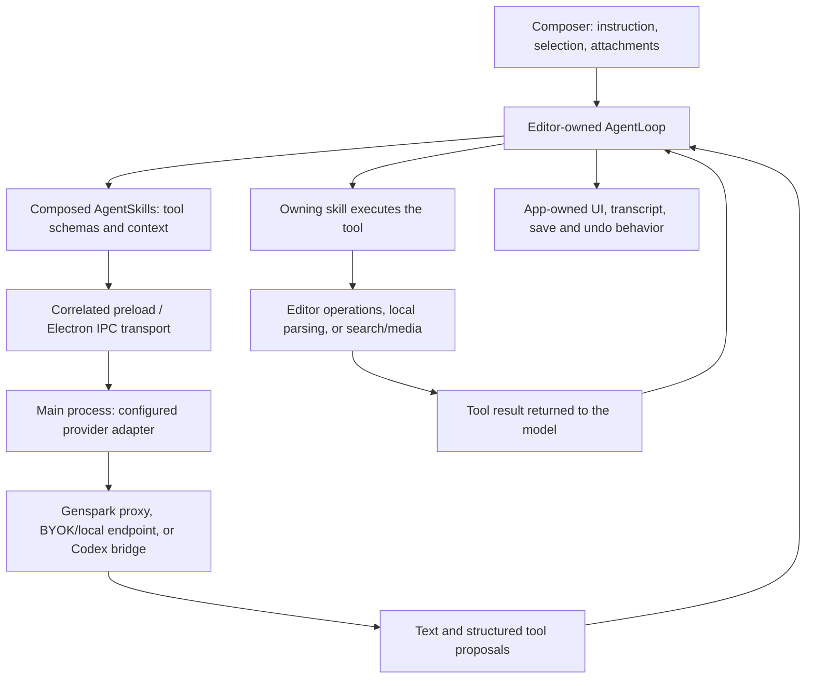

# GenOffice AI backend: renewed audit

Reviewed 20 October 2026. The engineering harness is **paused indefinitely** by
owner instruction. This audit changes documentation only; upstream was fetched
but was not merged into Infomonk. `assay.md` and unrelated `docs/research/` are
excluded.

## Conclusion

GenOffice already supplies the agent loop, tool composition, streaming model
transports, provider settings, document operations, local parsing, search,
CLI/MCP interfaces and editor persistence. Preserve these as the foundation.

Current upstream additionally supplies knowledge-base reading, imported document
skills, bounded in-app CLI execution, redundant-read protection, token accounting
and custom provider profiles. Several were absent at the original audit baseline.
They deserve evaluation and integration before proposing overlapping infrastructure.

This is not one remote agent server. The desktop application owns the agent loop
and executes tools; the selected model backend produces text and structured tool
requests. Genspark is one optional model/search/media route. Other configured
providers and local endpoints use the same application tool boundary.

## Reference snapshots and evidence

| Reference                              | Exact revision / result                                                                               |
| -------------------------------------- | ----------------------------------------------------------------------------------------------------- |
| Infomonk application audited           | `a4e787388c02a6eb52538e08e7c1ff8b1ea4e46f`                                                            |
| Original upstream / merge base         | `1ca5e9adfc1807a158db19741eff825dba9ab757`                                                            |
| Current upstream, fetched and unmerged | `1cb2925afe173b266c1545a3871a397429e11b7e`                                                            |
| Divergence at these snapshots          | 11 fork-only commits; 92 upstream-only commits                                                        |
| Current upstream CI                    | [Successful CI for this exact SHA](https://github.com/genspark-ai/genoffice/actions/runs/39416318270) |

The current upstream README and CONTRIBUTING were read directly from the fetched
revision, alongside the preserved README and local contributor guidance. Mutable
README marketing is not treated as runtime proof. Labels below distinguish
**source-confirmed**, **automated-test verified**, **local CLI exercised**,
**upstream CI reported** and **unverified integration**.

## How a request becomes an action

1. The editor constructs an `AgentLoop` with a transport and composed `AgentSkill`
   instances. A skill owns its prompt, tool JSON schemas, context builder and
   executor. Composition combines capabilities; it does not spawn sub-agents.
2. The transport correlates stream/cancel messages with request IDs through
   preload and Electron main. Main selects the configured model protocol and
   handles its network/subprocess stream. Provider code is not the tool executor.
3. The loop parses/coerces model tool arguments and invokes the owning skill.
   Tools in a returned batch run sequentially. Results enter conversation history
   for the next model turn. Tool-specific implementations perform editor changes,
   local reads, cloud searches or other exposed operations.
4. The application separately persists transcripts, applies mutations and saves
   artifacts. Optional loop snapshot hooks are not a universal artifact rollback.

Primary seams: `packages/agent-core/src/skill.ts`, `loop.ts`,
`electron-transport.ts`, `types.ts`; `packages/ai-provider/src/stream.ts`,
`registry.ts`, `protocols/*`; Sheets `App.tsx`, `ai/*-skill.ts` and main
`sheets-main.ts` streaming handlers. These source-confirmed contracts are already
present in Infomonk; the fork did not modify agent-core, ai-provider or ai-search.

## Existing capabilities and limits

| Capability                | What it actually supplies                                                                                                              | Reuse / verification boundary                                                                                                                                                                       |
| ------------------------- | -------------------------------------------------------------------------------------------------------------------------------------- | --------------------------------------------------------------------------------------------------------------------------------------------------------------------------------------------------- |
| Agent loop and skills     | Tool schemas, argument handling, multi-turn execution, events, cancellation signal, history/compaction, retries and no-progress guards | Reuse unchanged; fork core tests pass. Each new capability needs an executor; a prompt alone cannot grant it.                                                                                       |
| Providers                 | Shared Anthropic, Gemini, OpenAI-compatible and Codex routing; app settings and optional Genspark proxy                                | Reuse transports/settings. Provider tests are mocked; credentials and live account availability were not exercised.                                                                                 |
| Codex bridge              | Uses Codex app-server as a model backend with caller-supplied tool proposals; built-in tools are disabled                              | It does not give Infomonk a shell/browser research runner. Older-CLI read-only fallback comments acknowledge whole-disk read access; do not equate all permission profiles with isolated execution. |
| Workbook tools            | Read workbook/ranges, propose structured operations, formulas, charts and formatting through the inherited engine/journal              | Reuse native operations. Native sheet changes do not become accepted research facts automatically.                                                                                                  |
| Attachments and selection | Local parsing, paged text reads, selected range context and multimodal image preparation                                               | Parsed text/images can enter the chosen remote model's context. Local parsing is not a promise that inference stays local.                                                                          |
| Stop                      | Cancels active transport, invalidates late callbacks and supplies an AbortSignal to cooperative tools                                  | Completed mutations remain. Some tool implementations do not propagate the signal to their underlying operation.                                                                                    |
| Undo / rollback           | Editor-specific snapshots, command journals and save/recovery paths                                                                    | Core `rollbackFailedRun()` removes failed conversation history. Sheets supplies no loop `captureSnapshot` hook; Stop is not an artifact transaction rollback.                                       |
| Citations                 | Workbook `sheetnav` navigation, web result URLs and file links                                                                         | Preserve Infomonk's additional immutable snapshot/hash/locator/excerpt evidence. A navigable link alone does not establish field provenance.                                                        |
| Model limits              | Default 100 model turns, history/compaction/output/watchdog limits and retry guards                                                    | No hard monetary budget. Future research-specific limits must be explicit rather than inferred from the disabled engineering-policy preparation values.                                             |
| Search / media            | Web/image search, image generation/editing, image/audio/video analysis; configured capability-specific providers                       | Reuse these tools. They make provider requests; referenced media may be uploaded. README claims about local document commands do not describe every cloud command.                                  |
| Local file search         | SQLite full-text index and local text extraction; optional Jev reranking                                                               | Reranking may send up to 20 excerpts of 1,200 characters to its selected endpoint. Text extraction is not schema-aware research extraction.                                                         |
| Persistence               | Per-file/project chats, settings, editor history and Infomonk's separate research ledger                                               | Reuse each for its own purpose. Chat history, UI draft queues and durable research runs have different semantics.                                                                                   |

### CLI and MCP are substantial existing execution surfaces

The CLI already supports `info`, `create`, `convert`, DOCX/XLSX/PPTX read/apply/check,
slide audit/render/replace, PDF reading, merge, rendering, guides and GUI
open/selection. Structured operation DSLs invoke the same Office engines.

There are three distinct MCP entry points:

- **CLI stdio MCP:** command-backed document tools and staged
  `deck_start` / `deck_page` / `deck_build` / `deck_replace`; an open app is not
  required, though rendering/conversion may launch a hidden app process.
- **CLI HTTP MCP:** the same document tools plus session upload/download stores;
  default HTTP file access is confined to its store, with separate network/token
  configuration.
- **App HTTP MCP:** optional loopback tools driving visible Docs/Sheets/Slides
  sessions and open-document/PDF operations. It does not expose the Infomonk
  accepted-data ledger or publication API.

Source anchors: `packages/cli/src/cli.ts:52`, `mcp/server.ts:95`,
`apps/shell/src/main/mcp/app-mcp.ts:116`. The existing slide pipelines are
artifact-building machinery, not a general website extraction runtime.

## What current upstream adds

These are available in the pinned upstream source, **not yet integrated into
Infomonk**.

| Upstream addition          | Actual capability and boundary                                                                                                                              | Infomonk implication                                                                                                                                                       |
| -------------------------- | ----------------------------------------------------------------------------------------------------------------------------------------------------------- | -------------------------------------------------------------------------------------------------------------------------------------------------------------------------- |
| Imported document skills   | Discovers candidates, explicitly imports selected skills into app-owned storage, parses SKILL.md and exposes `list_skills`, `read_skill`, `run_cli` in Docs | Reuse inventory/parser/consumer patterns. Copied helper files do not gain arbitrary execution. Do not claim every editor already composes this skill.                      |
| Bounded `run_cli`          | Executes the bundled GenOffice CLI, not an arbitrary executable; eight args, 200 chars each, bounded output and 120-second execution                        | This is not a document-subcommand allowlist or a generated-code sandbox. Administrative CLI commands remain selectable, and external file writes are not live-editor undo. |
| Knowledge-base skill       | Starred-file list/search/paged reads with injected storage operations; Docs and shell Ask AI consumers                                                      | Reuse before building another retrieval system. Add project ownership/routing for Infomonk; global file stars are not accepted cell evidence.                              |
| File citations             | Rejects citation paths outside the supplied corpus/allowed outputs                                                                                          | It checks cited-path membership, not factual entailment or a citation for every claim; responses without citations are not rejected by this guard.                         |
| Create-document skill      | MD/DOCX output from the knowledge-base panel with tool-success checks                                                                                       | Reuse this source-backed output seam before inventing another document writer.                                                                                             |
| Redundant-read guard       | Detects repeated non-mutating calls/results, nudges the model and stops sustained churn                                                                     | Directly relevant to repeated-reading costs. It does not replace deterministic recurring data collection.                                                                  |
| Token usage and chat queue | Provider/IPC/loop/UI usage propagation plus queued future drafts                                                                                            | Usage can be unknown, is not a spending cap, and excludes summary calls. Chat draft queuing is not durable collection scheduling. Codex does not emit usage here.          |
| Custom provider profiles   | Cohesive endpoint/protocol/headers/model-capability/probe configuration                                                                                     | Integrate the whole compatible change, including types, IPC, settings and tests.                                                                                           |
| Opt-in request tracing     | JSONL can contain source content, prompts and responses; main wiring confirmed in Docs                                                                      | Preserve opt-in behavior; do not describe it as universal all-editor tracing or enable it for an audit.                                                                    |

Pinned source: [agent-core](https://github.com/genspark-ai/genoffice/tree/1cb2925afe173b266c1545a3871a397429e11b7e/packages/agent-core/src),
[in-app CLI](https://github.com/genspark-ai/genoffice/blob/1cb2925afe173b266c1545a3871a397429e11b7e/apps/shell/src/main/user-cli.ts),
[Docs skill consumer](https://github.com/genspark-ai/genoffice/blob/1cb2925afe173b266c1545a3871a397429e11b7e/apps/docs/src/renderer/ai/skills-skill.ts).

## Concrete gaps to verify before extension

- **Infomonk profile routing:** CLI GUI/control/cloud settings discovery honors
  `GENOFFICE_USER_DATA` and otherwise derives GenOffice profiles. The shell uses
  `INFOMONK_USER_DATA` / Infomonk Dev. Default CLI open/selection, overwrite
  protection and provider lookup can miss the active Infomonk profile. Headless
  engine success does not prove visible Infomonk integration.
- **Hidden upstream capability:** the new knowledge-base entry is in Home's
  sidebar. Infomonk embeds Home under Local files and hides that sidebar. A clean
  source merge would not make this feature reachable.
- **Cancellation preparation interval:** fork and current upstream can still call
  `loop.run()` after asynchronous image preparation resolves, even if Stop/New
  Chat occurred during preparation. The new draft queue does not invalidate that
  promise. This is a source-confirmed risk, not a runtime-reproduced defect.
- **CLI mutation reporting:** imported CLI execution reports `mutated:false`.
  Existing mutation/no-progress and rollback assumptions require a deliberate
  adapter for external file changes.
- **Website execution:** generic browser inspection, learned site recipes and
  isolated generated-script execution are not supplied by these existing tools.
  This identifies a capability gap, not authorization to implement a harness.

## Executed verification

All checks used the existing installed runtime. No provider credentials were
inspected and no live model/search/media request was made.

| Check                                       | Executed result                                                                              |
| ------------------------------------------- | -------------------------------------------------------------------------------------------- |
| Current fork agent-core                     | 166 passed across 9 files                                                                    |
| Current fork ai-provider                    | 417 passed, 1 failed across 30 files                                                         |
| Exact extracted upstream agent-core         | 216 passed across 12 files                                                                   |
| Local parser text/OOXML/ZIP suites          | 85 passed                                                                                    |
| CLI/MCP/skill/capability suites             | 43 passed, 1 initial workbook-info failure                                                   |
| Focused DOCX/CLI rerun                      | 17 passed, 18 name-filtered skips; earlier workbook-info test passed                         |
| Source CLI diagnostic                       | Eight workbook-info calls passed: four serial and four concurrent                            |
| Mocked search/provider-routing/media suites | 53 passed; no live provider requests                                                         |
| Built CLI 0.10.0                            | Help, nine-block synthetic supplier DOCX reading and native XLSX Sheet1 inspection succeeded |

The provider failure is an inherited Windows fixture: joining a temporary path
with a literal absolute Windows-style `codex.exe` child path produces an invalid fixture path
and ENOENT. It is not evidence of a live provider failure. The initial CLI exit-3
failure did not reproduce; its cause remains unidentified because that assertion
did not print the captured error envelope. Do not silently call the entire suite
green.

Vitest initially encountered sandbox TEMP cache rename failures. Process-local
TEMP/TMP overrides to ignored cache directories or escalated test execution
allowed the checks to run. Upstream core was extracted exactly from the pinned
Git revision into `.task/upstream-ai-audit-1cb2925a` and tested with installed
Vitest 4.1.11; it has no fork runtime imports. That verifies the upstream core
package, not a resolved upstream+Infomonk application build.

See the companion [upstream compatibility plan](upstream-compatibility-2026-10-20.md)
and [machine-readable audit manifest](ai-stack-2026-10-20.json). The harness remains
paused after this audit; no automatic resumption is implied.
