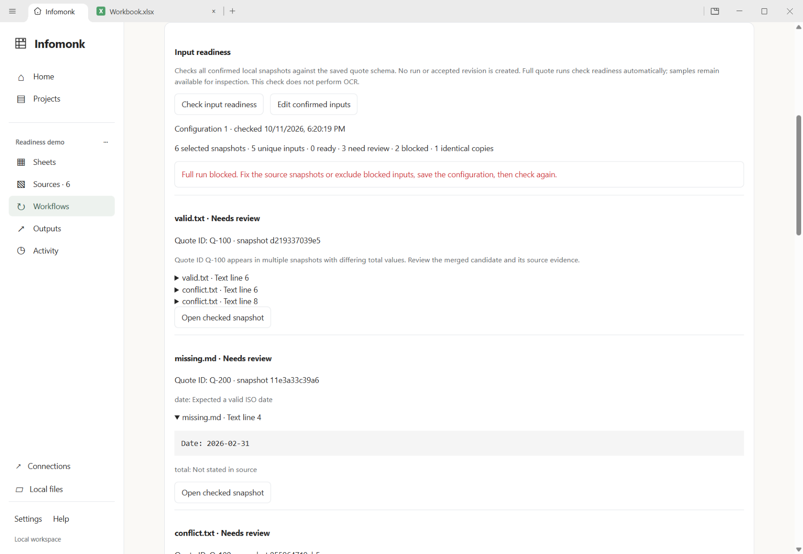
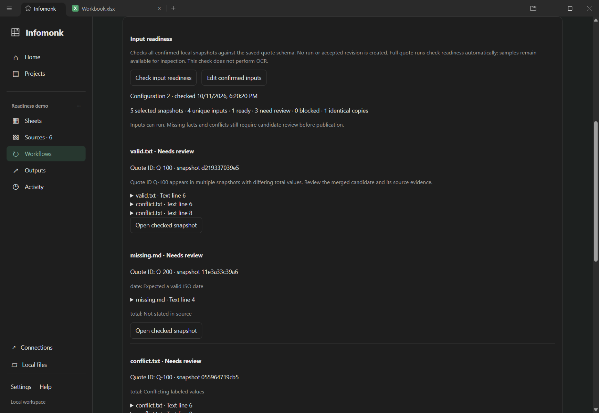

# Local quote input readiness — 11 October 2026

Saved quote workflows now check all confirmed snapshots before a requested full
run. Users can see the unsupported file or missing key, inspect actual excerpts,
repair a snapshot or explicitly change scope, and run the remaining reviewable
facts. Checking creates no run or accepted revision. The engineering harness
remains **last and disabled**; `assay.md` remains excluded.

## Executed mixed-batch journey

The independently expected fixtures combine `valid.txt`, `missing.md`,
`conflict.txt`, a keyless quote, a PDF with no text layer and an identical copy
of the valid text. The PDF contains only a rectangle; it tests missing text
coverage rather than OCR accuracy. Fixtures and expected outcomes are in
[`fixtures/infomonk/readiness`](../../fixtures/infomonk/readiness/README.md).

1. Save the six-input workflow and run a diagnostic sample. It has one quote and
   cannot publish. Checking leaves that sample in review and accepted revision 0.
2. Readiness reports **six selected snapshots, five unique inputs, three needing
   review, two blocked and one identical copy**. The keyless quote and textless
   PDF block full execution, including a direct preload/IPC request. The invalid
   date excerpt `Date: 2026-02-31` is visible at Text line 4. Missing facts and
   differing values remain review warnings; no value or key is invented.
3. Update the keyless source to the independently authored Q-300 snapshot through
   Sources. Explicitly exclude the textless PDF, then save configuration version 2.
   Unsaved edits disable check/full actions. Rechecking reports **five selected,
   four unique, one ready, three needing review, zero blocked and one copy**.
4. Run all confirmed inputs. The earlier sample becomes retained obsolete history,
   and the full candidate has three quotes. Accepted data remains unchanged until
   issues are acknowledged and publication is explicitly requested.
5. Accepted revision 1 contains **Q-100 total null, Q-200 total null and Q-300
   total 22**. Conflicting/missing facts stay missing. No renderer errors were
   captured during this journey.

A separate native journey changes a source after a successful check. The displayed
check becomes outdated; requesting a full run checks current bytes again, reports
the missing key and creates no run or accepted revision.





The captures were visually inspected. They show readable counts, actual snapshot
identities, missing-fact/conflict messages and expandable evidence. They are native
Electron captures, not mockups. The isolated profile/identities/checks are recorded
in [journey.json](input-readiness-2026-10-11/journey.json).

## Implementation and reused functions

| Seam                                      | Behavior and evidence                                                                                                                                                                                     |
| ----------------------------------------- | --------------------------------------------------------------------------------------------------------------------------------------------------------------------------------------------------------- |
| `InputReadiness` / `ResearchPanel`        | Read-only explicit check, save-before-run guidance, stale state, excerpt expansion and existing native source opening; mixed-batch and stale-state native tests                                           |
| Shared API, preload and `research/ipc.ts` | Additive main-frame/project/workflow-validated readiness action; full quote requests recheck before queueing; direct IPC blocker native-tested                                                            |
| `ResearchService.readiness`               | Existing `boundedRead`, SHA verification, `parseSource`, `extractQuote` and `mergeDatasets`; no second parser, database or scheduler; unit tests cover cache reuse, tampering and concurrent/stale checks |
| `research/readiness.ts`                   | Ready/review/blocked findings, identical-byte diagnostics and real merged quote/item disagreements; bounded payloads and DOCX/PDF locators unit-tested                                                    |
| `ResearchStore.prepare/publish`           | Incoming missing/conflicting Quote IDs block new publication, including retry/schedule paths; service and direct store rejection unit-tested                                                              |
| Selected-run detail state                 | Desktop testing exposed a late response clearing an opened absent-record list. The list now clears when the run/update/accepted revision changes; native protected-removal regression passes              |

Repeated readiness checks and full execution reuse verified parses. Cache keys
include processing version, SHA and extension; the cache holds at most 16 MiB
of serialized UTF-8 text and clears on close or overflow. Each check/execution
still verifies snapshot bytes. Returned findings are capped at 12 per input with
the full count, three excerpts per finding and 500 characters per excerpt.
Truncation is labeled; full candidate evidence remains available separately.

## Verification

Windows PowerShell, Node 24.13.1, npm 11.8.0, Electron 43.7.6, Vitest 4.1.11 and
Playwright 1.62.1. The committed npm lockfile and existing native/editor builds
were reused. The shell build recompiles every application's main/preload bridges.
Exact commands, checked source hashes and outcomes are in
[results.json](input-readiness-2026-10-11/results.json).

```powershell
node fixtures/infomonk/readiness/generate.mjs
npm run build -w @genoffice/shell
npm run typecheck
npm run test -w @genoffice/shell -- tests/research-readiness.test.ts tests/research-journeys.test.ts tests/research.test.ts tests/research-hardening.test.ts tests/workspace-flow.test.ts tests/workspace-store.test.ts tests/workspace-portability.test.ts tests/clean-table.test.ts
$env:Path = 'C:\Program Files\Git\usr\bin;' + $env:Path
npm run test:e2e -- infomonk-readiness.spec.ts infomonk-process-journeys.spec.ts infomonk-workspace-flow.spec.ts infomonk-hardening.spec.ts infomonk-research-context.spec.ts sheets-edit-save.spec.ts sheets-open-tsv.spec.ts sheets-csv-inplace-save.spec.ts sheets-csv-export.spec.ts sheets-filter-reopen.spec.ts ai-panel-side-settings.spec.ts theme-pipeline.spec.ts
npm run test:e2e -- infomonk-readiness.spec.ts
npm run lint
npm run format:check
npm run check:theme-colors
npm run check:english-comments
npm run licenses
```

Focused unit tests: **57 passed across eight files**, including nine new readiness
tests. All **26 workspace type checks** passed. Lint has **zero errors and the same
12 inherited warnings**. Shell build, formatting, theme-color, English-comment and
production-license checks passed.

All **22 distinct selected native tests** passed across the combined regression
run and focused readiness rerun. The combined run had 21 passes and a readiness
test selector failure: Update snapshot has a source-specific accessible name.
After matching that actual label, both readiness tests passed. Earlier development
also corrected the Sources count label and fixed the real absent-list race; no
business assertion was weakened. These tests cover protected source removal,
workflow reuse, cleanup, paging/restore, context changes, supplier comparison,
save/restart, CSV/TSV, filters, assistant placement and themes. Git's already
installed `unzip` was added only to the test process PATH.

Historical reports/screenshots remain intact. Current regression JSON records
are copied into this report's artifact folder. Full inherited Shell/Sheets suites
and native engine tests were not rerun for this increment: the previously documented
21 Windows path/symlink/chmod failures remain. No whole-repository-green claim is
made. Engine source, locks, licenses/notices and provider settings did not change.

## Limits and next work

- Readiness supports the saved deterministic supplier-quote family only:
  TXT/Markdown, DOCX and PDFs with readable text. It does not perform OCR, arbitrary
  document understanding, web acquisition or model extraction.
- Review warnings do not certify truth. Full candidate review, complete coverage,
  snapshot/configuration/processing/revision fences and metadata capacity still
  govern publication. Readiness does not guarantee every permitted batch fits
  the existing 16,777,216-character projection bound. The cache bound is serialized
  data size, not a measured peak-memory guarantee.
- Retries/schedules use the existing acquisition path and may expose diagnostic
  candidates with bad keys; the publication fence rejects their incoming missing
  keys. Existing accepted revisions and retained legacy rows are not repaired or
  rewritten. Identity reconciliation and explicit override clearing remain gaps.
- Next: a report from a selected accepted table/revision with visible missing
  facts and durable evidence references, reusing inherited writers. Then clarify
  chosen working-workbook transformations. Broader source families and release
  work need their own evidence. Implement the engineering harness last.
