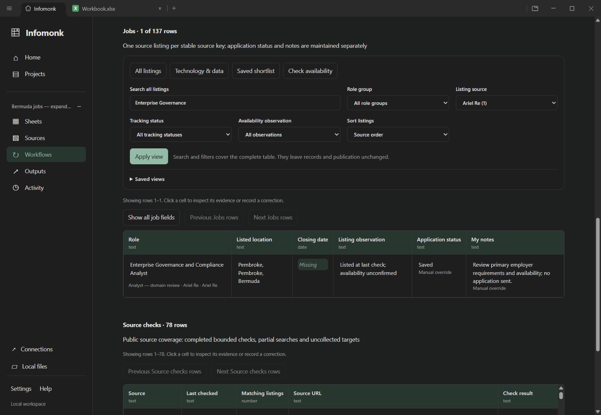
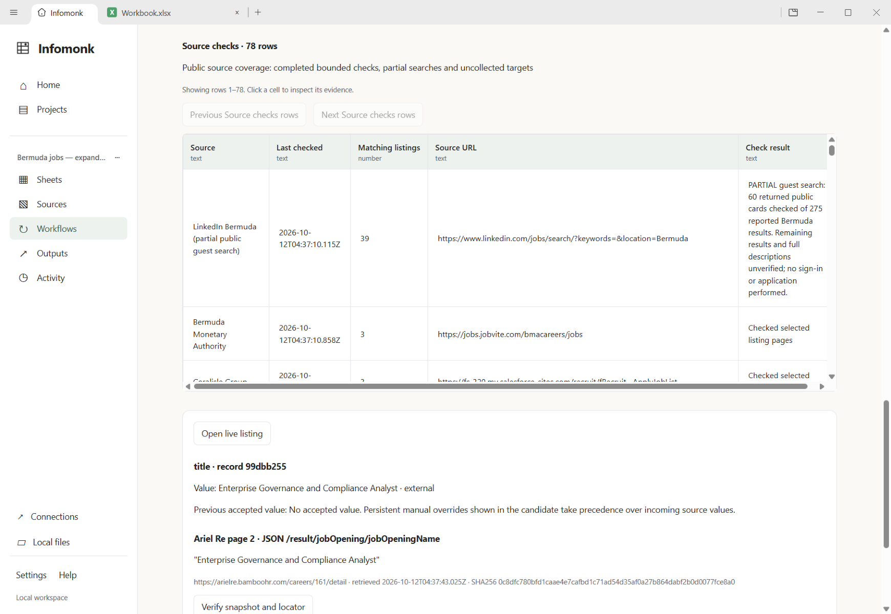

# Bermuda jobs: broader collection and coverage review

The original three-site, 14-listing pilot was insufficient. This pass collected
**137 source listings through 26 supported public source checks**, and audited
**78 registered targets individually**. The scope remains technology, data and
office roles, with manual workspace refresh. This is a broader tested search;
it is still an incomplete Bermuda market search.

The [coverage inventory](../testing/bermuda-coverage-2026-10-12/coverage-inventory.json)
connects every target to its actual evidence and limits. **52 targets remain
outside automatic tracker collection**, including manually inspected employers.
Careers-page inspection, selected vacancy details, complete declared-query
pagination and unresolved access are different states. Targets can overlap:
Aspen's primary route now redirects to Sompo; PwC client recruitment and PwC
employee recruitment are separate purposes. Neither domains nor target counts
are a reliable count of independent employers searched completely.

## Executed automatic collection

All 26 selected source checks completed their declared acquisition route in the
native application. Zero below means zero collected matches in that route,
with the stated restrictions; it is not a claim of no vacancies at an employer.
The [live record](../testing/bermuda-coverage-2026-10-12/live-results.json)
contains exact role URLs, retrieval timestamps, isolated project/workflow IDs,
all 137 records and all 78 coverage rows.

| Source check                  | Collected source listings | Main boundary                                                                                                   |
| ----------------------------- | ------------------------: | --------------------------------------------------------------------------------------------------------------- |
| LinkedIn Bermuda              |                        39 | Partial signed-out search: 60 returned cards of 275 reported results; descriptions/remaining results unverified |
| Bermuda Monetary Authority    |                         3 | Recognized public listing/detail pages                                                                          |
| Coralisle Group               |                         3 | Includes an All Jurisdictions lead requiring location confirmation                                              |
| Expertise Group               |                        12 | Unnamed agency clients; talent pools and location conflicts retained                                            |
| JobsInBDA / Royal Gazette     |                         0 | Returned advertisements and pages checked; title rules and current publication availability restrict scope      |
| Hamilton Recruitment          |                        30 | All returned public cards; agency clients/deadlines unstated, mirrored IDs reconciled                           |
| CCS Group                     |                         3 | Recognized public vacancies                                                                                     |
| Clarien Bank                  |                         3 | Public page/PDF details; role location remains contextual                                                       |
| One Communications            |                         3 | Entire bounded BambooHR list/details, explicit location filtering                                               |
| Bermuda Skyport               |                         1 | Entire bounded BambooHR list/details                                                                            |
| Artex Talent Solutions        |                         4 | Public recruiter results; role location and client review                                                       |
| Island Paradise Recruitment   |                         6 | Public title-based matching; client/deadline unknown                                                            |
| Deloitte                      |                         8 | Every linked result page checked; future intake may be listed                                                   |
| AXIS                          |                         1 | Selected explicit Bermuda country/location facet, all pages/details                                             |
| Arch Capital                  |                         0 | No Bermuda country/location facet exposed at this check                                                         |
| Hiscox                        |                         0 | No Bermuda country/location facet exposed at this check                                                         |
| Athora                        |                         1 | Selected explicit Bermuda facet, all pages/details                                                              |
| Everest                       |                         1 | Selected explicit Bermuda facet, all pages/details                                                              |
| Chubb                         |                         5 | All Bermuda-keyword query pages; not an exhaustive country-filtered census                                      |
| Apex Group                    |                         1 | Selected explicit Bermuda facet, all pages/details                                                              |
| Sompo                         |                         1 | Selected explicit Bermuda facet, all pages/details; actuarial role is adjacent                                  |
| Ariel Re                      |                         1 | Entire bounded BambooHR list/details; configured publisher identity is internal                                 |
| SiriusPoint                   |                         1 | All 27 published board posts checked; retained lead has NYC headline/Bermuda office conflict                    |
| Fortitude Re                  |                         0 | All 35 board posts checked; no explicit Bermuda title-scope match                                               |
| Performance Solutions         |                         6 | Entire bounded recruiter list/details; employer clients unstated, physical/logistics duties flagged             |
| Government of Bermuda careers |                         4 | Portal, both result pages and matching details captured; 13 listed vacancies reviewed                           |

The government collector reuses the durable queue. Its public widget publishes
fixed anonymous guest tenant selectors used solely for vacancy search/detail
endpoints. No login, account or application endpoint is called. The
[independent probe](../testing/bermuda-coverage-2026-10-12/government-live.json)
verified seven captures, 10 + 3 list records, four exact matching IDs and their
calendar deadlines. The portal's literal 7 pm Bermuda cutoff and API timezone
remain explicit evidence; the API timestamp is not treated as an application cutoff.

## Primary checks outside automatic collection

These observations are retained separately; they are not silently added to the
137 automatically maintained source listings. Web-tool results may be cached;
fresh browser DOM and actual HTTP captures have separate evidence labels.

- **Bermuda Hospitals Board:** all three visible list pages were inspected,
  20 + 20 + 11 = 51 listings. Primary details confirm Business Intelligence
  Specialist and Director Learning & Talent Development with 21 October
  employer deadlines. Employee Relations Manager and Cashier remain selected
  leads with details/deadlines unverified. The earlier newspaper's 20 October
  BI date conflicts with the employer portal; preserve both sources and resolve
  before relying on the later date. [Employer portal](https://bermudahospitals.bm/work-at-bhb/bhb-jobs-now/external-applicants/).
- **KPMG Bermuda:** all 19 landing-page detail links were attempted; 18 were
  inspected, two explicitly closed and one unresolved. IT Manager and IT Risk
  & Governance Senior Manager explicitly identify Bermuda and 16 October.
  The shared PeopleHR host does not establish Cayman location. Undated and
  future-cycle recruitment remain uncertain; 16 non-explicitly-closed leads
  are not 16 verified current openings. [Primary listing](https://kpmg.com/bm/en/careers/experienced-hires/employment-opportunities.html).
- **Ocorian, Carey Olsen, Teneo and Appleby:** explicit Bermuda corporate,
  trust and financial advisory leads were inspected. Selected details and
  indexed older postings do not establish complete current lists. Appleby's
  current cards include programmes and a mailing-list entry; older office-role
  details absent from those cards remain availability-unconfirmed.
- **Hamilton Princess / Accor:** both terminal results in the employer-linked
  query identify Hamilton, Bermuda. The expiry value `01/01/0001` is a sentinel,
  not a real deadline. **Aon:** its Bermuda country query has two results on one
  terminal page, Property Broker and Managing Director — Life Solutions;
  domain/fit review and detail checks remain. [Aon result page](https://jobs.aon.com/jobs/locations/country/Bermuda).
- **PartnerRe:** four listing pages and all 56 captured detail pages were
  reviewed using explicit location microdata. One Bermuda CAT Underwriter is
  outside the selected title scope; no selected match was found in these
  captures. This is not a market-wide zero claim.
- **ACT, IEP and Carrick:** evergreen intake/capacity invitations remain talent
  leads, not counted vacancies. **Steph Brown:** explicit Bermuda role blocks
  have unnamed clients and missing dates; conflicting duties/requirements need review.
- **Butterfield, HSBC, CML, BTA, Ontru and other dynamic portals:** boundaries
  or selected leads were inspected; unresolved widgets, images or pagination
  prevent complete collection. **Job Connect:** the fresh public landing page
  routes sign-in, pathway and recruitment actions to login; no public vacancy
  list was visible. No account was opened.
- **Institutional employers:** inspected no-current-position statements are
  retained as dated source observations, not general zero-vacancy claims.
  BermudaJobFinder's previously examined estate/caveat notice is not a job;
  its exact page now returns 404. It remains excluded from vacancy publication.

See [new-source discovery](bermuda-source-discovery-2026-10-12.md),
[17 older-target checks](../testing/bermuda-coverage-2026-10-12/remaining-discovery-checks.json),
[fresh browser checks](../testing/bermuda-coverage-2026-10-12/employer-browser-checks.json),
[primary HTTP captures](../testing/bermuda-coverage-2026-10-12/primary-http-checks.json)
and [PartnerRe detail review](../testing/bermuda-coverage-2026-10-12/partnerre-reviewed.json).
The inventory covers the registered targets; additional employers identified
through trade/member directories remain discovery work, not completed checks.

## Accuracy and native workspace flow

The grain is **one source listing per stable source key**. Cross-site recruiter
reposts, broad pools and multi-role adverts prevent a defensible distinct-vacancy
total. The independent exported-workbook check found 137 unique record IDs and
listing keys, correct dates/observation ordering, well-formed evidence references,
and a preserved shortlist/note after restart. **101 employer values are missing;
26 are configured publisher identities marked internal; only 10 are captured
reported employer names. 124 deadlines remain unknown.** Sixteen listings have
location review flags; adjacent/domain review is separately retained.

The native journey created the project, selected all supported sources, inspected
an actual Ariel listing snapshot, reviewed/published revision 1, saved a
demonstration shortlist and note (revisions 2–3), collected again and published
revision 4. Search and source filters cover all stored listings before paging.
The app was closed/restarted; all pages, unique identities, Saved status and
note persisted. The accepted native workbook reopened with both BambooHR and
Workday cell evidence. Scheduling remains manual/null. No application or alert
was submitted. The earlier demo and its personal hospital note remain intact.

The [quality companion](../testing/bermuda-coverage-2026-10-12/quality-check.mjs)
checks the full XLSX research metadata; [results](../testing/bermuda-coverage-2026-10-12/quality-results.json)
record every exception rather than hiding missing facts.

## Next bounded increment

1. Join reviewed browser/document observations to the same listing identity and
   tracking history, starting with BHB and KPMG; then Butterfield/HSBC and
   Ocorian/Carey Olsen. Capture complete selected scopes and exact original
   evidence; preserve conflicting dates, location and closed/programme status.
2. Resolve recruiter widgets and image/PDF adverts; distinguish current vacancy,
   talent pool and mixed physical/office duties before publishing. Add broader
   department/duties matching with independent expected cases: KPMG's generic
   “Manager” title demonstrates why title rules alone miss technology roles.
3. Reconcile cross-site vacancy identity without discarding source observations
   or personal notes; let native-sheet correction actions update the same
   reviewed ledger. Keep provider/permission-dependent sources explicit.

The data engineering harness remains disabled and last. The successful Windows
journey and focused checks are recorded in the
[verification manifest](../testing/bermuda-coverage-2026-10-12/results.json).
Jobs processing version 3 prevents older pending candidates from publishing
under the changed provenance rules. Cancel an older pending candidate and run
again; prior accepted tables and source history remain readable.
