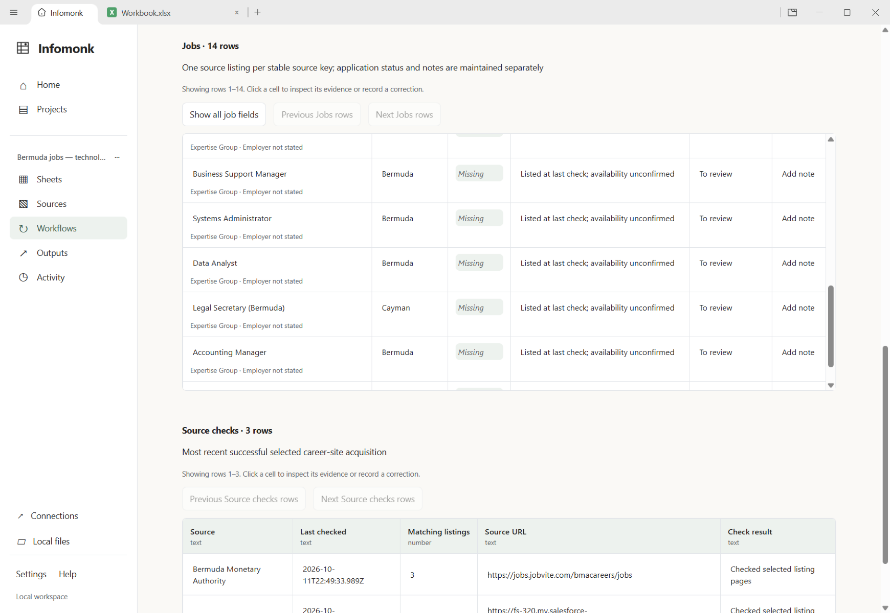
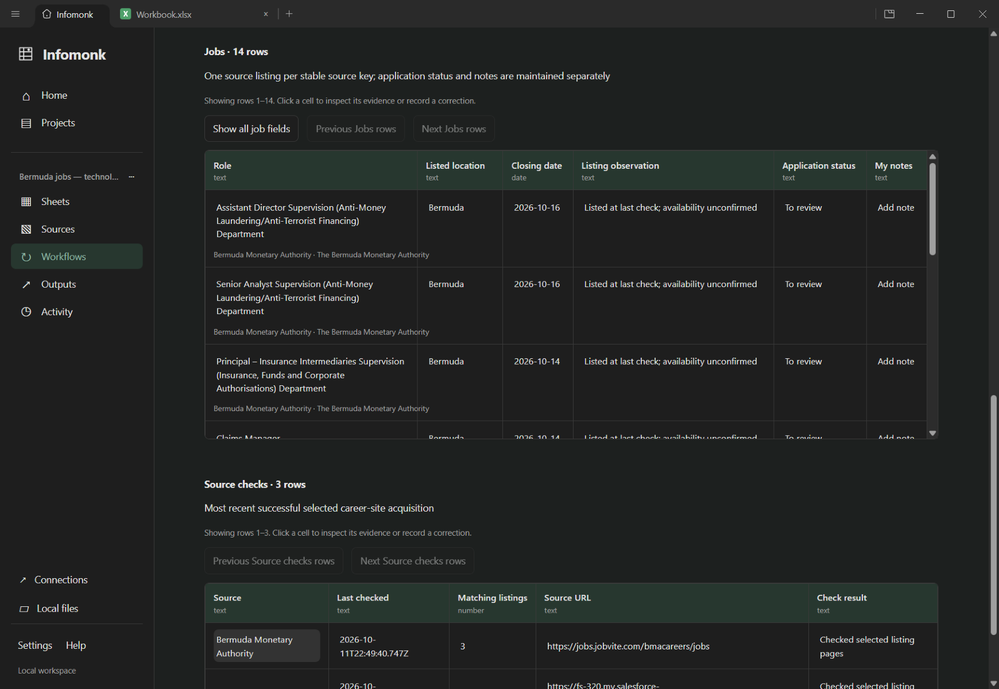
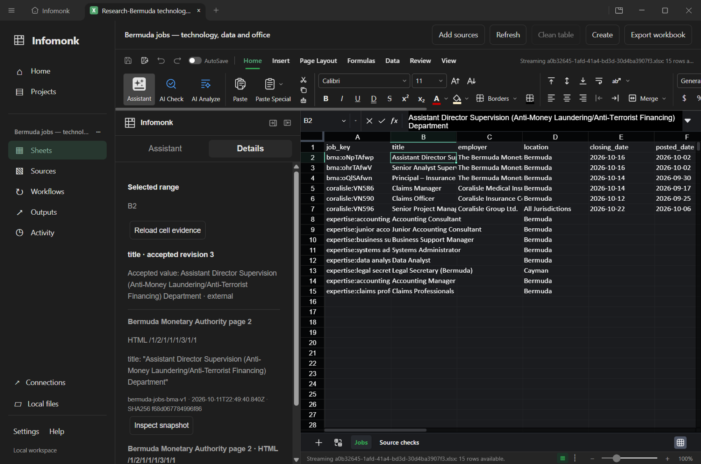

# Bermuda jobs: full workspace use case

**Historical three-site pilot.** The owner correctly rejected this as insufficient
coverage. The [expanded search and source audit](bermuda-jobs-wide-2026-10-11.md)
supersedes this result. The original evidence remains available for comparison.

On 11 October 2026, Infomonk collected **14 source listings from three websites**
for technology, data and office roles. **Twelve list Bermuda; two need location
review.** The native desktop journey verified source evidence, published the
tracker, saved a demonstration shortlist status, refreshed manually, and reopened
the accepted workbook with native cell evidence. This is a selected-site sample,
not a guarantee of 14 distinct vacancies or currently open applications.

## Live results

| Checked career site                                                                      | Listings in the selected scope | Boundary                                                                                    |
| ---------------------------------------------------------------------------------------- | -----------------------------: | ------------------------------------------------------------------------------------------- |
| [Bermuda Monetary Authority](https://jobs.jobvite.com/bmacareers/jobs)                   |                              3 | Bermuda regulatory/office roles; explicit deadlines in detail pages                         |
| [Coralisle Group](https://fs-320.my.salesforce-sites.com/recruit/fRecruit__ApplyJobList) |                              3 | Two Bermuda roles and one All Jurisdictions role requiring location confirmation            |
| [Expertise Group](https://www.expertisegroup.com/available-jobs)                         |                              8 | Agency clients/deadlines are unstated on the checked page; one title/location contradiction |

The closer technology/data matches include **Systems Administrator** and **Data
Analyst** on Expertise's page. **Senior Project Manager** on Coralisle's page
describes technology delivery, but its jurisdiction is not specifically Bermuda.
Office listings include Business Support Manager and Accounting Manager. No
qualification-fit, work-permit eligibility, salary estimate or application is inferred.

The [live result record](../testing/bermuda-jobs-2026-10-11/live-results.json)
contains role facts, exact URLs, actual timestamps, isolated profile/project/workflow
IDs and accepted revision. Raw HTML and the ledger stay in the local demo profile;
they are not committed to the public repository. The local exported workbook is
`working_dir/bermuda-jobs/Bermuda-Jobs-Tracker.xlsx`.

## Executed flow

1. Create a research project; select Bermuda jobs, confirm all three sites and
   save the task. The app uses public fixed routes and declared title matching.
2. Run full collection. All three selected sites complete, and a candidate shows
   missing facts and uncertain locations before any accepted data changes.
3. Select Data Analyst and verify its immutable source excerpt. Publish after
   acknowledging issues; the first accepted tracker is revision 1.
4. Set that listing to Saved, with an explicit demonstration reason. Revision 2
   records the personal shortlist choice. **No application was sent.**
5. Use Refresh job listings. The real sites are fetched again, review preserves
   Saved, and publication creates revision 3. Scheduling remains manual/null.
6. Close/restart the app using the isolated demo profile. Reopen the accepted
   workbook, select its native B2 cell, and inspect the original role evidence
   through Sheets Details. The shortlist remains Saved after restart.

The compact tracker puts application status and notes beside role, location,
deadline and observation. Show all job fields exposes every stored field; the
workbook retains all 15 fields and native record IDs. This addresses the too-wide
default table found during the first live inspection.

Open the saved local demonstration with
`working_dir/bermuda-jobs/Open-Bermuda-Jobs.ps1`. It uses the isolated demo profile
and opens its accepted workbook, so Workflows and native cell evidence remain
connected. The separately exported XLSX is a portable snapshot, not the ledger.

## Data-quality findings

The grain is **one source listing per source key**, with separate personal tracking.
The independently checked profile has 14 rows and unique listing keys; six rows
have a named employer and deadline, and eight agency rows have those fields missing. Twelve rows
list Bermuda, one says All Jurisdictions, and Legal Secretary (Bermuda) lists Cayman.
Those two are review items, not confirmed Bermuda jobs. Non-Bermuda ordinary
listings are excluded from the selected scope.

- **Location validity — high, high confidence:** 2/14 (14.3%) need review because
  of broad or contradictory source locations. Confirm with the employer/recruiter
  before treating them as eligible Bermuda roles. The values remain unchanged.
- **Completeness — medium, high confidence:** 8/14 (57.1%) agency rows omit employer
  and deadline on the checked page. Keep explicit nulls; read/contact the recruiter
  for the specific role. Do not invent dates or attribute the agency as the employer.
- **Identity — medium:** provider IDs are stable for six listings; eight agency
  keys use title/location. Reposts and undisclosed clients limit cross-site dedupe.
  Exact duplicate keys are rejected, and named-employer/title similarities are
  flagged. There is no claim of 14 unique real-world openings.
- **Timeliness — medium:** timestamps describe actual retrieval. Listed means
  observed then, not guaranteed still accepting applications. Bermuda calendar-day
  deadlines distinguish due today from past deadline. Manual refresh is required.

Synthetic tests verify source failure, stale/unsupported layouts, bounds, duplicate
keys, deadline-day handling and missing-listing retention. They do not establish
real-world closure or broader job-search accuracy. The reviewed tracker remains
usable with missing facts; application choices/notes are user-owned data.

## Failure and change journey

The independent synthetic corpus starts with four listings, including an unnamed
agency client and conflicting location. A sample cannot publish. Full review
publishes; Saved and a personal note create revisions 2–3. An injected offline
site then fails collection and leaves revision 3 intact.

A later successful collection replaces Data Analyst with Systems Administrator
and changes a Systems Analyst deadline from 16 to 18 October. The disappeared
Data Analyst remains marked not found, retains its previous last-seen date, Saved
status and personal note, and is never labeled closed. After publication/restart,
revision 4 still contains those tracking facts. This complements the real-site
refresh, which cannot deliberately manufacture a genuine website disappearance.

Permanent tests and independently expected fixtures:
[`infomonk-jobs.spec.ts`](../../e2e/infomonk-jobs.spec.ts),
[`research-jobs.test.ts`](../../apps/shell/tests/research-jobs.test.ts),
[`fixtures`](../../fixtures/infomonk/jobs/README.md). The
[implementation contract](../implementation/bermuda-jobs.md) records actual scope,
privacy, evidence, publication and identity boundaries. The
[verification manifest](../testing/bermuda-jobs-2026-10-11/results.json) records
commands, environment, outcomes and source hashes. The independent
[quality companion](../testing/bermuda-jobs-2026-10-11/quality-check.mjs) checks the
accepted metadata embedded in the exported workbook; its
[results](../testing/bermuda-jobs-2026-10-11/quality-results.json) retain the missing
facts and location exceptions.

Verification passed 64 focused tests, 24 selected Electron tests, all 26 workspace
type checks, Shell/Sheets builds, lint (12 existing warnings), theme/comment checks
and license checks. Both jobs Electron tests passed again after the final public-site
export attribution fix. The shared electron-utils suite passed 254 tests and failed
three tests in unchanged Windows path/chmod code. Historical broader Shell/Sheets
unit failures were not rerun; this record does not claim a completely green full suite.

## Remaining use-case gaps

1. **Broader discovery:** the Government Job Board timed out during research;
   JobsInBDA requires JavaScript, Butterfield's current portal is dynamic, and an
   old indexed SiriusPoint role redirected away. These did not become zero-job
   claims or accepted rows. Add separately validated adapters or a reviewed browser
   acquisition path later; this task does not execute arbitrary websites.
2. **Richer agency evidence:** linked PDF details, employer/qualification extraction,
   and explicit repost identity need their own measured workflow. Title matching
   can miss relevant roles and does not rank personal suitability.
3. **Review ergonomics:** change counts include acquisition dates/source versions,
   so a new check can change a record without a changed vacancy fact. Compare the
   relevant fields. A later facts-only change summary and cross-source reconciliation
   would reduce noise; missing-listing retention already prevents false closure.

This use case required a bounded jobs adapter and clearer tracking presentation,
while reusing the ledger, queue, review UI, source inspector, file writers and native
spreadsheet engine. No generated-code runner, additional processing framework,
credential change or notification automation was added. The engineering harness
remains the final phase.
