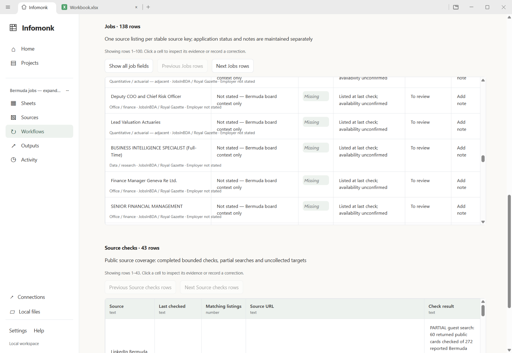
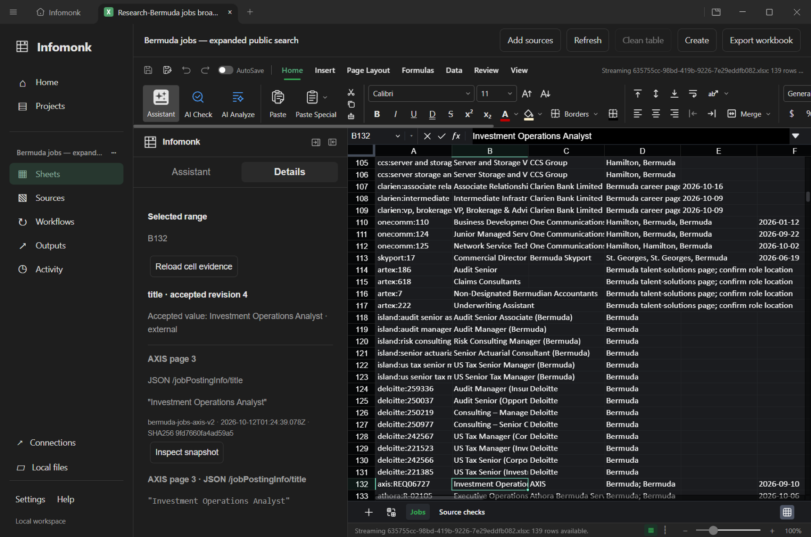

# Bermuda jobs: expanded search and coverage audit

**Historical 19-source run.** The [12 October coverage review](bermuda-coverage-2026-10-12.md)
supersedes its counts with 26 supported source checks, 137 source listings and
an individually evidenced 78-target inventory. This earlier demo and its personal
deadline note remain intact.

The original result was **14 listings from only three websites**, and the owner
correctly rejected its breadth. This run expands the tracker to **138 source
listings from 19 configured public-source checks**, with **43 coverage targets**
recorded. Twenty-four targets were not acquired by the automated task; some were
manually investigated. This is materially broader but remains an incomplete
market search. The count is not 138 distinct or confirmed-open vacancies.

Checked on 11 October 2026 in Bermuda time; execution timestamps extend into
12 October UTC. Scope: technology, data and office roles; manual workspace refresh.
No application, account creation or notification subscription occurred.

## Actual public coverage

| Source                                                                                                 | Matching source listings | Checked boundary                                                             |
| ------------------------------------------------------------------------------------------------------ | -----------------------: | ---------------------------------------------------------------------------- |
| [LinkedIn Bermuda](https://www.linkedin.com/jobs/search/?keywords=&location=Bermuda)                   |                       35 | **Partial:** 60 guest cards of 272 reported results; descriptions unverified |
| [BMA](https://jobs.jobvite.com/bmacareers/jobs)                                                        |                        3 | Recognized list and selected details                                         |
| [Coralisle](https://fs-320.my.salesforce-sites.com/recruit/fRecruit__ApplyJobList)                     |                        3 | One list and selected details; All Jurisdictions needs review                |
| [Expertise](https://www.expertisegroup.com/available-jobs)                                             |                       12 | Vacancy blocks, including multiline titles; unnamed clients                  |
| [JobsInBDA / Royal Gazette](https://www.jobsinbda.com/)                                                |                       20 | All returned advertisements/pages screened; matching JobPosting details      |
| [Hamilton Recruitment](https://hamilton-recruitment.breezy.hr/)                                        |                       29 | List cards; exact mirrored IDs reconciled; detail requirements unverified    |
| [CCS](https://www.ccs.bm/careers/)                                                                     |                        3 | Employer headings and explicit Hamilton-office context                       |
| [Clarien](https://clarienbank.com/careers/)                                                            |                        3 | Employer cards and deadlines; PDF requirements unverified                    |
| [OneComm](https://onecomm.bamboohr.com/careers)                                                        |                        3 | Entire public list/details; explicit Bermuda locations filtered              |
| [Skyport](https://bermudaskyport.bamboohr.com/careers)                                                 |                        1 | Entire public list/details; title rules exclude trades/security              |
| [Artex](https://phe.tbe.taleo.net/phe03/ats/careers/v2/searchResults?org=FRONTIER&cws=40)              |                        4 | All returned details; all four describe talent pools, not current needs      |
| [Island Paradise](https://www.islandparadiserecruitment.co.uk/job-openings)                            |                        6 | Bermuda-named cards; clients/deadlines unstated                              |
| [Deloitte](https://talentsourcing.deloitte.com/cbcapply/SearchJobs)                                    |                        8 | All six linked results pages; includes future intake opportunities           |
| [AXIS](https://axiscapital.wd1.myworkdayjobs.com/axiscareers)                                          |                        1 | Verified Bermuda facet and all filtered pages/details                        |
| [Arch](https://archgroup.wd1.myworkdayjobs.com/careers)                                                |              0 collected | No Bermuda facet exposed; not a market-wide zero-job claim                   |
| [Hiscox](https://hiscox.wd3.myworkdayjobs.com/Hiscox_External_Site)                                    |              0 collected | No Bermuda facet exposed; not a market-wide zero-job claim                   |
| [Athora](https://athora.wd3.myworkdayjobs.com/athora-careers)                                          |                        1 | Verified Bermuda facet and all filtered pages/details                        |
| [Everest](https://wd5.myworkdaysite.com/recruiting/everestre/careers)                                  |                        1 | Verified Bermuda facet and all filtered pages/details                        |
| [Chubb](https://fa-ewgu-saasfaprod1.fa.ocs.oraclecloud.com/hcmUI/CandidateExperience/en/sites/CX_2001) |                        5 | Bermuda-keyword results then actual locations filtered; intake review needed |

The [source audit](../testing/bermuda-jobs-wide-2026-10-11/source-audit.json)
records all targets, primary HTTP attempts, acquisition boundaries and dispositions.
Landing-page inspection is distinct from full vacancy collection. A guessed
careers route returning 404 does not establish no jobs. Uncollected counts/dates
stay null in the app, including after refresh. Run completion refers to the
configured public view, not whole-site coverage.

Uncollected targets include Job Connect, government careers, Platinum, both PwC
paths, KPMG, BHB, Butterfield, HSBC, RenaissanceRe, Aspen, SiriusPoint, Fortitude,
Athene, Fireminds, Digicel, EY, Conyers, Appleby, BELCO, Saltus, Hamilton
Princess/Accor, Bermuda Executive Services and BermudaJobFinder. Their evidence
levels vary; some current career routes remain unverified.

## Employer checks that changed the interpretation

The [legacy Job Board](https://bermudajobboard.bm/) announces its migration to
[Job Connect](https://www.bermudajobconnect.bm/). The new site's application leads
to sign-in/register; authenticated jobs were not collected. The
[government's official search link](https://www.gov.bm/online-services/search-government-jobs)
led to HTTP timeouts/fetch failures and browser `net::ERR_ABORTED`. Both remain
important coverage gaps rather than zero-job sources.

The [hospital's official public portal](https://bermudahospitals.bm/work-at-bhb/bhb-jobs-now/)
was manually checked across **three pages, 51 rows**, with Next Page disabled on
the last page. Its Business Intelligence Specialist, job **737**, confirms
**Pembroke**, posted **9 October**, with employer deadline **21 October 2026**.
The role covers cloud data-lake analytics, data models, governance and dashboards.
Manual reading of the newspaper image confirms BHB and the same role, but it
states **20 October**. The portal says “apply before 21 October” and its description
lists **21 October**. This date/cutoff ambiguity is unresolved: plan for the earlier
20 October and confirm the exact cutoff with BHB; no extension is inferred.
JobsInBDA's corresponding board metadata omits employer/location and expires for
publication on **11 October**. That expiry is not the employer deadline. This
confirmation remains a separate observation; board facts were not silently filled.

The [Butterfield Bermuda page](https://www.butterfieldgroup.com/careers/our-locations/bermuda)
links SuccessFactors. Its public Bermuda-jurisdiction search returned two jobs
on one page: **Lending Assistant, 1846**, posted 6 October, and **Trust
Administrator, 1874**, posted 2 October. The latter's detail confirms transactional
and administrative support for Trust Services. These manually checked leads are
outside automatic refresh; employer deadlines remain unestablished.

[Manual lead records](../testing/bermuda-jobs-wide-2026-10-11/manual-leads.json)
also preserve BHB's Employee Relations Manager and Director Learning & Talent
Development, with detail-review limits. The latter is a concrete miss in current
title rules. BermudaJobFinder reports 163 listings, but only its first 20 cards
were verified; a second distinct page was not verified during this check.

## Data quality and useful matches

Independent checks against the **entire accepted XLSX metadata**, not just the
first 100-row IPC page, found 138 unique source keys. Title-rule groups are:

- **7 technology** and **3 data/research** listings.
- **78 office/finance** and **10 analyst roles requiring domain review**.
- **38 adjacent actuarial/quantitative**, one broad recruiter pool and one mixed advertisement.

Closer technology/data leads include Expertise's Systems Administrator and Data
Analyst, CCS's two server/storage consultants, OneComm's Junior Managed Services
Engineer and Network Service Technician, the BHB BI role, and Platform X user
experience. Clarien's infrastructure engineer remains listed with a **9 October
deadline**, already past. Presence is not proof of current availability.

There are **106 missing employer identities**, **129 missing employer deadlines**,
**20 known publication-expiry dates**, **two past employer deadlines**, **four
talent-pool observations**, and **31 records prompting location review**. LinkedIn
advertiser is separate from employer; many recruiter clients are undisclosed.
Multi-role advertisements and repeated cross-site postings are source observations.
A defensible distinct-vacancy count cannot yet be established. No personal
eligibility or qualification-fit ranking is claimed.

The [quality check](../testing/bermuda-jobs-wide-2026-10-11/quality-check.mjs) and
[results](../testing/bermuda-jobs-wide-2026-10-11/quality-results.json) verify keys,
all-page counts, partial-source labels, missing facts, expiry/deadline separation,
tracking preservation and observation times.

## Executed workspace flow

1. Create an isolated project, choose Bermuda jobs, select all 19 supported sites,
   save and collect their bounded public scopes through the existing queue.
2. Choose Review candidate and inspect missing facts. Navigate both 100-row pages, verify BI
   evidence, acknowledge issues and publish accepted revision 1.
3. Save BI to the demonstration shortlist and add a personal note. No application
   is sent; status/note corrections are separate from employer observations.
4. Manually refresh every selected site, choose Review candidate, preserve Saved and the note,
   and publish revision 4. The workflow schedule remains null/manual.
5. Close/restart, inspect every accepted table page and reconcile all 138 rows to
   source counts. Reopen the owned native workbook.
6. Inspect BI HTML and AXIS Investment Operations Analyst JSON evidence in native
   Sheets Details. Both resolve immutable stored snapshots.

The expanded report is also saved as an immutable project source. Its employer
cross-checks and coverage limits are available through Sources and survive restart;
adding that research does not change the accepted jobs revision.

After reading the image, a separate personal-note correction records the 20/21
October deadline ambiguity and source links. This creates accepted revision 5,
preserves Saved and leaves the metadata-derived employer/deadline cells unchanged.
The owned workbook and portable export now contain that reviewed note.

The run exposed and fixed a review-display bug: selecting an already selected
run cleared its preview without requesting it again. An explicit reload generation
now reloads the same run, and Review candidate makes that action visible. The
native test reselects the same candidate twice before publication.

The [manifest](../testing/bermuda-jobs-wide-2026-10-11/results.json) and
[live result](../testing/bermuda-jobs-wide-2026-10-11/live-results.json) record exact
commands, environment, profile, revision, all rows and coverage. Raw snapshots and
the ledger stay in the ignored local profile. The exported
`working_dir/bermuda-jobs/Bermuda-Jobs-Tracker-Wide.xlsx` is portable; the local
launcher opens the owned workbook so workflow history/evidence remain connected.

## Ranked remaining gaps

1. **Reviewed browser/document acquisition.** Prioritize Job Connect/government,
   BHB/Butterfield and remaining recruiters. Capture current employer details,
   image/PDF adverts and explicit coverage/blocks into the same evidence model.
   These portals cannot yet participate in automatic jobs refresh.
2. **Evidence-backed vacancy reconciliation and broader discovery.** Correlate
   recruiter/employer identities, IDs and descriptions while preserving observations.
   Cover the known HR title miss without inflating confirmed vacancy counts.
3. **Search and review ergonomics.** Add saved role/source/availability/shortlist
   filters and facts-only change summaries. Paging works, but 138 rows make
   individual review slower than necessary.

This expansion reuses projects, sources, durable execution, accepted revisions,
corrections, native writers and evidence inspection. No processing framework,
dependency upgrade, paid request, new database, hosted scheduler or generated-code
runner was added. The data engineering harness remains the very last phase.
